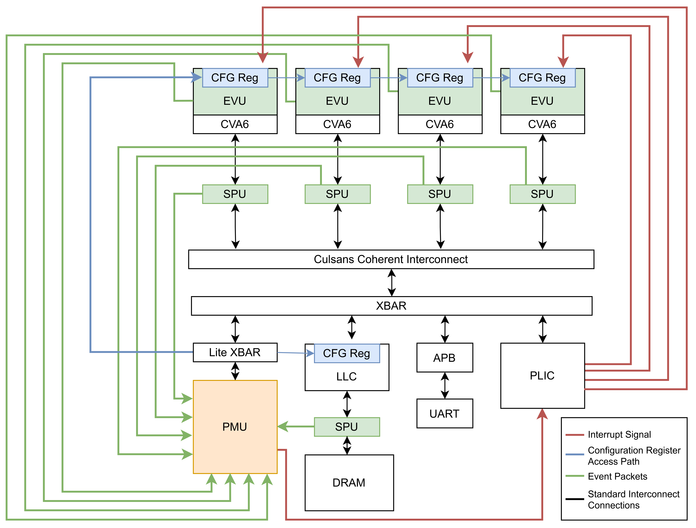

# he-soc — Centralized Performance Monitoring on a PULP-based SoC

This repository is the **integration showcase** for the performance-monitoring architecture in our EMSOFT 2026 paper. It drops our monitoring IPs — the per-core **Event Monitoring Units (EVUs)**, the **SPU** event snoopers, and the central **Advanced Performance Monitoring Unit (APMU / PMU)** — into a real RISC-V / PULP SoC (AlSaqr: quad-core CVA6 with CULSANS coherency), so the whole infrastructure can be seen working end-to-end rather than as standalone IP.

> **Paper:** M. S. Jafri, A. Rahman, E. Sarkar, M. Hassen, G. Thayyil, A. K. Mani, and R. Pellizzoni, *"A Centralized Performance Monitoring Architecture for Heterogeneous Multicore SoCs,"* **EMSOFT 2026**, University of Waterloo.

> **Artifact evaluation (EMSOFT 2026).** Active development of this artifact continues in this GitHub repository: https://github.com/Rodolfo-Pellizzoni-Lab/he-soc.

<p align="center"></p>

*Each **CVA6** core carries an **EVU**; **SPUs** sit on the coherent interconnect and at the LLC↔DRAM port. They forward microarchitectural **event packets** (green) to the central **PMU**, which counts and correlates them and can raise **interrupt signals** (red) back to the cores through the PLIC — for example, to drive real-time memory-bandwidth regulation.*

## What's in here

### Hardware — the monitoring IPs

All under `hardware/ip_list/`, wired into the SoC in `hardware/host/host_domain.sv`:

| IP | Path | Role |
|----|------|------|
| **CVA6 + EVU** | `ip_list/cva6/` | RISC-V application core, extended with the Event Monitoring Unit (`core/perf_counters_evu.sv`) that exports microarchitectural events. |
| **APMU (PMU)** | `ip_list/apmu/` | The centralized monitor — programmable event counters plus an Ibex processing element for event-driven software mechanisms. |
| **SPU** | `ip_list/spu/` | AXI/ACE snooper that captures interconnect- and memory-side events and forwards them to the PMU. |
| **ibex_pmu** | `ip_list/ibex_pmu/` | The Ibex core used as the APMU's processing element (lowRISC Ibex + our PMU-counter interface). |

Note that the **CVA6 used here has been augmented to include the EVUs** — it is not the stock CVA6 core. This EVU-augmented core is open-sourced as a standalone `cva6` repository.

### Hardware — modified last-level cache

The **AXI-LLC** (`ip_list/axi_llc/`, the upstream PULP last-level cache) carries two Waterloo modifications that the paper's regulation and contention experiments rely on: a **pseudo-LRU (PLRU) replacement policy** (`src/hit_miss_detect/axi_llc_plru.sv`) and **AXI-ID-based cache partitioning** — AXI4-Lite config registers assign each master a way bitmask, so LLC capacity can be allocated per core. See its [README](./hardware/ip_list/axi_llc/README.md).

### Software — bare-metal tests

Under `software/` (each builds a `.riscv` plus the memory image; see *Building & running* below):

- **`pmu_test/`** — APMU bring-up: programs the PMU counter bundles and runs a bubble-sort program on the APMU's **Ibex processing element** (loaded into its ISPM/DSPM scratchpads), checking the core and the counter-register interface work.
- **`pmu_cntr_test/`** — quad-core memory-traffic benchmark: each core streams its own disjoint 320 KB L3 region (load + store per cache line) while the PMU counts **per-core LLC and main-memory read/write requests**; cores 2/3 are woken by counter-overflow → PLIC IRQ.
- **`pmu_evu_bench/`** — CVA6-EVU profiling: the APMU's Ibex uses **PC-milestone windows** (function entry/exit) to profile two CVA6 functions — a pure-ALU chain vs a cold-load-heavy one — via the EVU events (L1D misses, stalls, branches), showing they produce distinct profiles.
- **`hello_culsans/`** — minimal dual-boot (CVA6 + OpenTitan) bring-up + UART sanity test.
- **`quad_boot/`** — brings up all four CVA6 cores (each prints a hello): core 0 boots and arms PMU counters 0/1 to overflow → PLIC IRQs that wake cores 2/3, while core 1 comes up on its own — a quad-core boot + PMU-interrupt-wakeup demo.

> **RTL simulation requires Siemens QuestaSim.** The flow generates a Questa compile script (`make scripts_vip`) and runs `vsim` — there is no open-source-simulator path today.

> **Paper software.** The tests under `software/` here exercise the monitoring infrastructure **in simulation**. The programs used to run the paper's **experiments and case studies on the VCU118 FPGA board** live in a separate repository: [`apmu-software`](https://github.com/Rodolfo-Pellizzoni-Lab/apmu-software).

## Built on AlSaqr

This platform **augments the existing [AlSaqr](https://github.com/AlSaqr-platform/he-soc) PULP-based he-soc** — a quad-core CVA6 SoC with CULSANS coherency, a last-level cache, HyperRAM/DDR memory, and an OpenTitan secure domain — by adding our EVU / SPU / APMU monitoring infrastructure on top. Full credit for the base SoC goes to the AlSaqr project; our contribution is the centralized performance-monitoring layer. The underlying AlSaqr SoC:


For the full AlSaqr-specific build details (upstream `make init`, L2/JTAG preload, OpenTitan secure boot, regressions), see the [upstream AlSaqr README](https://github.com/AlSaqr-platform/he-soc).


 * The `hardware` folder is organized as follows:

   - `deps` contains local component integrated in the SoC
   - `host` contains the host-system: it wraps the core and plugs it into the `axi_node` to which the slaves are attached
   - `tb` contains the testbench
   - `fpga` contains the scripts to generate the bitstream
   - `docs` contains the datasheet of AlSaqr SoC and the related padframe specification 

 * `software` contains the bare metals tests you can run on the SoC

## RISC-V Toolchain

AlSaqr requires the RISC-V toolchain which is available here: https://github.com/riscv-collab/riscv-gnu-toolchain

For the PULP CLuster make sure the PULP RV32 toolchain is in your PATH. Please refer to PULP RISCV GCC toolchain to use a pre-built release: https://github.com/pulp-platform/pulp-riscv-gcc

## Repo initialization

### Pellizzoni Lab repo (no `make init` needed)

This lab's fork (`git@github.com:Rodolfo-Pellizzoni-Lab/he-soc.git`) has all IP dependencies, VIPs, and the bender binary vendored directly into the default **`main`** branch. No network downloads or `make init` required.

**Step 1 — Clone (a fresh clone lands on `main`) and source:**
```
git clone git@github.com:Rodolfo-Pellizzoni-Lab/he-soc.git
cd he-soc
source uw_setup.sh
```

**Step 2 — Generate the QuestaSim compile script (fast, no network):**
```
cd hardware/
make scripts_vip
```

**Step 3 — Compile and run a test:**
```
make -C ../software/hello_culsans clean all
make clean sim
```

> **NB:** The bender binary is vendored on `main` (and its mirror `esarkar/quad-core/cva6-evu-standalone`), so a fresh clone already has it. Sourcing on the old default `former_master` will fail at `make scripts_vip`.

> **`source software/pulp-runtime/configs/pulp_cluster.sh`** — Only needed when running PULP cluster tests (tests under `software/pulp/`, `software/fpu_pulp/`, etc.). Skip it for all CVA6 tests including hello_culsans, PMU tests, and EVU tests.

---

### Generate TCL for simulation

Then, generate the tcl for simulation and synthesis. In he-soc/hardware run one of two following options accordingly to your target:

* RTL simulation:
```
make scripts_vip
```

* RTL simulation using gf22 macros (this requires the gf22 repository to be cloned and initialized into he-soc/hardware folder, as well as fll's one):
```
make scripts_vip_macro
```
By default, the elf binary will be preloaded into L3.

To load the code through JTAG interface, you can add the `localjtag=1` option to the previous command, for instance: `make localjtag=1 scripts_vip`.
Be aware that the preload of the code is slower in this case.


### Run the test

 * Option 1: in the he-soc/hardware folder run (the test to be run shall be compiled first, as the command runs automatically the simulation with the last tests that has been compiled):

```
make -C ../software/"test you want to run" clean all
make clean sim
```

The code that will be laoded is the last that has been compiled. Thus, to run a test with preload in L3, you shall compile the test you want to run (as shown above) and then run the simulation without providing the path to the binary.

In case of localjtag preload, you need to provide the path to the binary you want to execute. `make clean sim elf-bin=../software/hello_culsans/hello_culsans.riscv` if you used the localjtag preload flag.

 * Option 2: go to the test folder (ex `software/hello_culsans`)
 
```
make clean all sim
```

## Running on the VCU118 board

The paper's results were produced on a Xilinx **VCU118** FPGA. The bitstream-generation flow is under [`hardware/fpga/`](./hardware/fpga/) (AMD Vivado, VCU118 target); see that directory to build the bitstream, program the board, and load a program, then run the case-study software from [`apmu-software`](https://github.com/Rodolfo-Pellizzoni-Lab/apmu-software). This flow requires Vivado and the board — it is not push-button.

## Artifact evaluation

This repository is submitted for the **EMSOFT 2026 artifact evaluation** (we apply for the **Artifacts Available** badge). The standard artifact-evaluation documents live under [`docs/`](./docs/):

- [`docs/STATUS.md`](./docs/STATUS.md) — the badge we apply for and the reasons why.
- [`docs/REQUIREMENTS.md`](./docs/REQUIREMENTS.md) — the hardware and software needed to build and run the artifact (QuestaSim, Vivado, a VCU118 board, RISC-V GCC).
- [`docs/INSTALL.md`](./docs/INSTALL.md) — clone → build → run a bring-up test in simulation, with the expected output.

## License

Each IP we author ships its own **`LICENSE`** file inside its folder under `hardware/ip_list/`:

- **APMU** — [`hardware/ip_list/apmu/LICENSE`](./hardware/ip_list/apmu/LICENSE)
- **SPU** — [`hardware/ip_list/spu/LICENSE`](./hardware/ip_list/spu/LICENSE)

Both are released under the **Solderpad Hardware License v0.51**, which permits the work to be treated, at the licensee's option, as the **Apache License 2.0** — an OSI-approved open-source license. The CVA6 **EVU** carries the same Solderpad header and is licensed via its standalone `cva6` repository. The he-soc base SoC and all other upstream components (CVA6, lowRISC Ibex, AlSaqr) retain their original open licenses.

## Publication

If you use this performance-monitoring infrastructure in your work, please cite our EMSOFT 2026 paper:

```
@inproceedings{jafri2026centralized,
  author    = {Jafri, Mohammed Sajjad and Rahman, Abdur and Sarkar, Emon and Hassen, Mahdi and Thayyil, Gopishankar and Mani, Ashwin Krishna and Pellizzoni, Rodolfo},
  title     = {A Centralized Performance Monitoring Architecture for Heterogeneous Multicore SoCs},
  booktitle = {Proc. ACM SIGBED International Conference on Embedded Software (EMSOFT)},
  year      = {2026}
}
```

