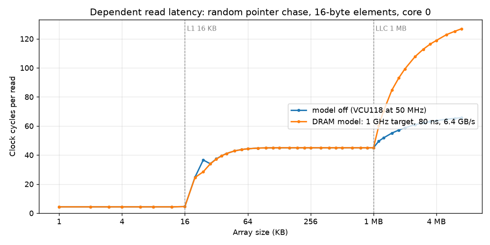

# DRAM timing model

`hardware/host/axi_dram_timing.sv` sits between the LLC's memory port and the DRAM path (host_domain). It is the
first step of a FASED-style memory model: the SoC clock is read as the clock of the target being emulated, one
SoC cycle per target cycle whatever the FPGA runs at, and every memory response is held until the DRAM of that
target would have delivered it. Requests still go to the real memory (the simulated DRAM in xsim, the DDR4 on the
VCU118) immediately; only the time at which the data becomes visible changes.

```
LLC memory port --AXI--> axi_dram_timing --AXI--> (SPU) --> DDR4 / simulated DRAM
                              ^ cfg / counters: SoC control registers 0x1A10_6100 (apb_soc_control)
```

The L1 data and instruction caches of CVA6 have 16-byte lines, the LLC 64-byte lines: a miss in the LLC-cached
window reaches the model as an 8-beat refill, while DRAM outside that window (the LLC passes it through) comes
as the L1's own 2-beat fills, so the bandwidth term is felt there as 2 beats of bus time rather than 8.

The model is on the memory side of the LLC, so it applies to every master whose DRAM traffic gets past the LLC,
not only to the cores: the accelerator socket's DMA (`hardware/accel`, a port of the coherence unit) pays the same
modelled latency and bandwidth on LLC misses and on DRAM outside the LLC's cached window, and nothing on LLC hits or
on the on-chip SRAM. `software/soc_tests/t_dma` measures it (step 7): DMA from DRAM outside the LLC window with
`LAT_RD = 256` against the same copy with the model off, and an SRAM-to-SRAM copy that must not change. In
simulation the device's copy from such DRAM goes from 75 to 320 cycles per 64-bit word (every word is one memory
read, and the model counted all 64 of them) while the SRAM copy stays at 63 cycles per word; on the VCU118 (bitstream `iotag`) the same step measures 120 to 364
and 106 to 106.

## Model

| Parameter | Meaning |
|---|---|
| `LAT_RD` | target cycles from the accepted AR to the first read beat |
| `LAT_WR` | target cycles from the accepted AW to the write response, plus the burst's bus time |
| `OCC16`  | data-bus time per 8-byte beat in 1/16 target cycles: bandwidth. A 64-byte line costs `8 * OCC16 / 16` cycles; 0 = unlimited |

A read accepted at time `t` gets its first beat at `max(t + LAT_RD, bus_free)` and the beats of the burst follow
`OCC16/16` cycles apart; `bus_free` then moves to the end of the burst. Writes take the bus the same way and
their response is released at `max(t + LAT_WR, bus_free) + burst time`. Reads and writes share the one bus.
Latency and bandwidth are the two things the real FPGA memory path gets wrong by an order of magnitude relative
to the cores (the DDR4 answers in a few tens of 50 MHz cycles and delivers far more bytes per cycle than any
target's memory), and they are what memory contention studies with the QoS controllers depend on.

Choosing values: for a 1 GHz target with a 16-bit LPDDR4-3200 channel (6.4 GB/s, about 80 ns to data),
`LAT_RD = 80`, `OCC16 = 16 * 8 / 6.4 = 20`. For a 2 GHz target the same memory is `LAT_RD = 160`, `OCC16 = 40`.
The device tree's `timebase-frequency` and `clock-frequency` become the target values, so Linux counts time in
target cycles; the UART keeps its divider (it is a host-time device).

When the real memory is slower than the model (the data arrives after its modelled time) the beat is released at
arrival and counted in `RD_LATE` / `LATE_CYCLES`: a measured error, not a hang. The second step, gating the SoC
clock while a response is overdue, removes that error. Responses are assumed in request order, which the simulated
DRAM and the DDR4 controller provide; the simulation reports a different ID at the head of the queue.

## Registers (SoC control + 0x100, 32-bit)

| Offset | Register | |
|---|---|---|
| 0x100 | CTRL | bit 0 enable (RW); bit 1 written 1 clears the counters. Enable can change at any time: requests are tracked in both modes and buffered responses drain first |
| 0x104 | LAT_RD | [15:0] |
| 0x108 | LAT_WR | [15:0] |
| 0x10C | OCC16 | [15:0] |
| 0x110 | RD_COUNT | read bursts accepted while enabled |
| 0x114 | WR_COUNT | write bursts |
| 0x118 | RD_LATE | reads whose first beat came back after its modelled time |
| 0x11C | LATE_CYCLES | sum of that lateness |
| 0x120 | HOLD_CYCLES | sum of the cycles first read beats were held back |
| 0x124 | ID | 0xD2A3_0001: the model is present in this bitstream |
| 0x128 | RD_BEATS | read beats delivered (8 bytes each) |

The generated SoC control block decodes only the low 8 address bits; apb_soc_control routes offsets 0x100-0x1FF
to the model's registers and everything else to the generated block.

## Measured (2026-10-15)

Model off (the real memory path, `t_dram` step 1):

| Access from core 0 | VCU118 at 50 MHz | xsim (simulated DRAM behind the CDC and delayer) |
|---|---|---|
| dependent 64-byte line read, L1 miss and LLC miss | 85 cycles | 82 cycles |
| dependent 16-byte L1 fill of DRAM outside the LLC window (passed through the LLC) | 62-63 cycles | 48-49 cycles |

With the model, on the VCU118 (bitstream `dram_model_b`, `t_dram` passes its 20 checks; 64 dependent line reads
per setting):

| Setting | Cycles per line read | Counters |
|---|---|---|
| `LAT_RD = 256` | 328 | 64 reads of 512 beats, 0 late, 242 hold cycles per read |
| `LAT_RD = 256`, bypass path (16-byte fills) | 312 | 64 reads of 128 beats |
| `LAT_RD = 1` | 87 | every read late, by 13 cycles |
| `OCC16 = 512` (32 cycles per beat) | 289 dependent, 291 streamed | |
| `LAT_WR = 300`, 64 dirty lines evicted from one set | | 65 write bursts, data read back correct |

The hold and late counters locate the memory's own share of the 85 cycles: the DDR4 path returns the first beat
about 14 cycles after the model accepts the read (256 - 242, and 1 + 13), and the other ~70 cycles are the L1
miss, the CCU, the crossbar and the LLC refill. Any `LAT_RD` of 20 target cycles or more is therefore met without
stalling the SoC clock, and for a 1 GHz target with any realistic DRAM latency (80-120 ns) the clock gate of the
second step would almost never close.

Under Linux (Buildroot, 433 MB of RAM) the model is configured with devmem from the shell. With the 1 GHz target
values (`LAT_RD = LAT_WR = 80`, `OCC16 = 20`) writing 32 MB into tmpfs took 26.7 s of host time against 12.4 s
with the model off, and reading it back 1.2 s against 0.7 s. The model saw 5.7 M reads of 2.04 beats on average
(the kernel's memory lies outside the LLC window, so its traffic is 16-byte L1 fills) and 4.4 M write bursts;
1 read was late, by 12 cycles.

## Latency sweep

`software/soc_tests/t_sweep` chases a random cyclic chain of 16-byte elements (one L1 line each) through arrays
of 1 KB to 7 MB in LLC-cached DRAM and prints the cycles per dependent read for every size, with the model off
and with the 1 GHz settings; `software/soc_tests/plot_sweep.py` draws its console log. On the VCU118:



| Array | Model off | 1 GHz settings | |
|---|---|---|---|
| up to 16 KB | 4.3 cycles | 4.3 | L1 hit: the L1 data cache of this configuration (`cv64a6_imafdc_sv39_wb`) is 16 KB, 8 ways of 16-byte lines |
| 128 KB to 1 MB | 45.0 | 45.0 | LLC hit: the model sees no traffic |
| 2 MB | 58.8 | 99.3 | |
| 7 MB | 65.7 | 127.0 | mostly DRAM; a 64-byte LLC line holds 4 elements, so a share of the hops still hit the LLC and the curve keeps climbing towards the pure miss (85 cycles in `t_dram`, whose chain thrashes one set) |

## Test

`software/soc_tests/t_dram` (in the `soc` regression suite and runnable on the board) measures the latency of a
dependent DRAM read with the model off, which is the number to calibrate against, then checks the fixed latency,
the late detection, the bandwidth limit on a dependent chase and on a stream, the write path and the pass-through
once disabled. On a bitstream without the model it only prints the real latency.

## Next steps

1. Gate the SoC clock (BUFGCE on the clock manager's output; the model and the DDR side on the free-running copy)
   while a response is overdue, so late responses stop being an error.
2. Per-bank row-buffer state and FR-FCFS ordering in place of the single bus, and per-RCID bandwidth regulation
   using the QoS tag that already travels on the memory port.
