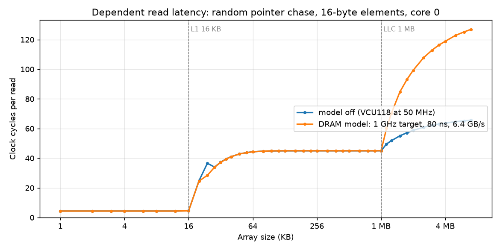

# DRAM timing model

`hardware/host/axi_dram_timing.sv` sits between the slowdown regulator and the DRAM path (host_domain). It is the
first step of a FASED-style memory model: the SoC clock is read as the clock of the target being emulated, one
SoC cycle per target cycle whatever the FPGA runs at, and every memory response is held until the DRAM of that
target would have delivered it. Requests still go to the real memory (the simulated DRAM in xsim, the DDR4 on the
VCU118) immediately; only the time at which the data becomes visible changes.

```
LLC memory port --AXI--> SPU --> slowdown --AXI--> axi_dram_timing --AXI--> DDR4 / simulated DRAM
                                                         ^ cfg / counters: SoC control registers 0x1A10_6100 (apb_soc_control)
```

With the slowdown regulator in the path (`hardware/ip_list/slowdown`, `` `define USE_SLOWDOWN `` in host_domain.sv)
the model sits after the SPU and the slowdown: it sees the request stream the slowdown releases, and the SPU's
latencies include both the slowdown's and the model's delays. The measurements below were taken before the
slowdown was added, with the model directly on the LLC's memory port, except those dated 2026-10-30 and later, which
have it in the path.

The L1 data and instruction caches of CVA6 have 16-byte lines, the LLC 64-byte lines: a miss in the LLC-cached
window reaches the model as an 8-beat refill, while DRAM outside that window (the LLC passes it through) comes
as the L1's own 2-beat fills, so the bandwidth term is felt there as 2 beats of bus time rather than 8.

The model is on the memory side of the LLC, so it applies to every master whose DRAM traffic gets past the LLC,
not only to the cores: the accelerator socket's DMA (`hardware/accel`, a port of the coherence unit) pays the same
modelled latency and bandwidth on LLC misses and on DRAM outside the LLC's cached window, and nothing on LLC hits or
on the on-chip SRAM. `software/soc_tests/t_dma` measures it (step 7): DMA from DRAM outside the LLC window with
`LAT_RD = 256` against the same copy with the model off, and an SRAM-to-SRAM copy that must not change. In
simulation the device's copy from such DRAM goes from 75 to 320 cycles per 64-bit word (every word is one memory
read, and the model counted all 64 of them) while the SRAM copy stays at 63 cycles per word; on the VCU118 (bitstream `iotag`) the same step measures 120 to 364
and 106 to 106.

## Model

| Parameter | Meaning |
|---|---|
| `LAT_RD` | target cycles from the accepted AR to the first read beat |
| `LAT_WR` | target cycles from the accepted AW to the write response, plus the burst's bus time |
| `OCC16`  | data-bus time per 8-byte beat in 1/16 target cycles: bandwidth. A 64-byte line costs `8 * OCC16 / 16` cycles; 0 = unlimited |

A read accepted at time `t` gets its first beat at `max(t + LAT_RD, bus_free)` and the beats of the burst follow
`OCC16/16` cycles apart; `bus_free` then moves to the end of the burst. Writes take the bus the same way and
their response is released at `max(t + LAT_WR, bus_free) + burst time`. Reads and writes share the one bus.
Latency and bandwidth are the two things the real FPGA memory path gets wrong by an order of magnitude relative
to the cores (the DDR4 answers in a few tens of 50 MHz cycles and delivers far more bytes per cycle than any
target's memory), and they are what memory contention studies with the QoS controllers depend on.

Choosing values: for a 1 GHz target with a 16-bit LPDDR4-3200 channel (6.4 GB/s, about 80 ns to data), `LAT_RD = 80`,
`OCC16 = 16 * 8 / 6.4 = 20`. For a 2 GHz target the same memory is `LAT_RD = 160`, `OCC16 = 40`. With the slowdown in
the path, which releases at most one address every 11 cycles (its README), a 64-byte line costs at least 11 cycles at
the memory port, more than `OCC16 = 20`'s 10: at the 1 GHz values the slowdown, not the model, sets the line
bandwidth. The device tree's `timebase-frequency` and `clock-frequency` become the target values, so Linux counts
time in target cycles; the UART keeps its divider (it is a host-time device).

The model can only hold data back, so a setting emulates its target only where the real memory answers sooner than the
model would. For an LLC line refill that means the whole line: the LLC answers the core only when all 8 beats are in
(in `t_dram`'s `OCC16 = 512` rows a hop whose first beat is not held grows by 7 x 32 cycles less the time the real
line takes after the accept: 289 - 85 = 224 - 20 on the MIG, 294 - 178 = 224 - 108 on the 10-30 bitstreams), so a
refill ends when the later of the modelled last beat and the real one leaves the model. The modelled last beat comes
`LAT_RD` + 7 x `OCC16`/16 cycles after the model accepts the read when its modelled bus is free (later behind a burst
still on it, and no sooner than `LAT_RD` + 7, as one beat leaves per cycle): 89 at the 1 GHz values. With the MIG's
own DDR4 controller, and with OpenDRAM at 1x timing, the first beat comes 14-15 cycles after the model accepts a read
and the line is complete about 20 cycles after it, so the 1 GHz values work as intended. With `OPENDRAM=1` as main
builds it (OpenDRAM with 16x DRAM timing, `alsaqr_opendram_ethernet_16x.bit`) how soon the memory answers depends on
the DRAM row (measured below). In `t_dram` an LLC line refill that has to open a new row gets its first beat 72-81
cycles after the accept (79-83 on the 10-30 bitstreams, with the slowdown), about the 1 GHz target's own latency, and
its last beat about 100-110 cycles after it, later than the 89: the 1 GHz values add next to nothing to such a refill.
A model effect needs a target whose modelled last beat comes later than the real one: for these refills from about
`LAT_RD = 92-102` at `OCC16 = 20`, in `t_sweep`'s 2 MB chase from about 90 (below); the 2 GHz values (`LAT_RD = 160`,
`OCC16 = 40`, last beat at 178) are well past both. A read of a row that is still open answers about 40 cycles sooner:
the 1 GHz values still add about 35 cycles on average to `t_dram`'s 16-byte fills, half of which find their row open
(more to those that do); for a whole line that depends on when its last beat comes, which has not been measured for an
open row. In the random chases of `t_part` and `t_sweep` the model-off latencies also stand for about the 1 GHz
target: `t_sweep`'s first beats mostly come sooner than `t_dram`'s, but in its 2 MB chase the lines are complete about
99 cycles after the accept on average and almost none before the 89 (`t_sweep_probe`, in the latency sweep below).
Both tests measure what the model adds at the 1 GHz values by its hold time per read and print
`1 GHz target not emulated` when that is under half of `LAT_RD`; that hold is the first beat's, so it is only a proxy
for what reaches the core.

While the model is enabled every beat spends at least a cycle in its buffer: it is due at its modelled time or one
cycle after it arrives, whichever is later (a held beat spends that cycle inside its hold). When the real memory is
slower than the model (the data arrives after its modelled time) the beat therefore leaves one cycle after it arrives.
A read whose first beat arrives after its modelled time is counted in `RD_LATE`, and that lateness, in whole cycles
and without the buffer cycle, in `LATE_CYCLES`. A first beat that arrives in the cycle it is due in (the first cycle
at or after its modelled time) also leaves a cycle late and adds nothing to `LATE_CYCLES` or `HOLD_CYCLES` (`RD_LATE`
counts it only when its modelled time, set by a bus time in 1/16 cycles, is not a whole cycle): a memory exactly as
fast as the model costs each read a cycle that the counters do not show. Later beats and write responses are not
judged. Lateness is a measured error, not a hang; the second step, gating the SoC clock while a response is overdue,
would remove it. Responses are assumed in request order, which the simulated DRAM and the DDR4 controller provide; a
response whose ID differs from the one at the head of the queue is reported in simulation.

## Registers (SoC control + 0x100, 32-bit)

| Offset | Register | |
|---|---|---|
| 0x100 | CTRL | bit 0 enable (RW); bit 1 written 1 clears the counters. Enable can change at any time: requests are tracked in both modes and buffered responses drain first |
| 0x104 | LAT_RD | [15:0] |
| 0x108 | LAT_WR | [15:0] |
| 0x10C | OCC16 | [15:0] |
| 0x110 | RD_COUNT | read bursts accepted while enabled |
| 0x114 | WR_COUNT | write bursts |
| 0x118 | RD_LATE | reads whose first beat came back after its modelled time. RD_LATE, LATE_CYCLES and HOLD_CYCLES only judge reads accepted while enabled and since the last clear, so RD_LATE <= RD_COUNT |
| 0x11C | LATE_CYCLES | sum of that lateness |
| 0x120 | HOLD_CYCLES | sum of the cycles first read beats were held back |
| 0x124 | ID | 0xD2A3_0001: the model is present in this bitstream |
| 0x128 | RD_BEATS | read beats (8 bytes each) arriving from the memory while enabled, including beats of reads accepted while disabled, which RD_COUNT does not count |

The counters are plain 32-bit counters and wrap without notice, so read them as differences over intervals short
enough not to wrap. `HOLD_CYCLES` and `LATE_CYCLES` add up cycles per read and `RD_BEATS` 8 per read, so they can
wrap within minutes (`RD_BEATS` in about 2 minutes at the slowdown's limit of one request every 11 cycles). Under
Linux with all 8 harts loaded (2026-10-31, `m8n8_fix_n8_20261030`; measured with the slowdown, below), at
`LAT_RD = LAT_WR = 256` and `OCC16 = 512`, `HOLD_CYCLES` read 60.5 M after 9.5 minutes for 40.9 M reads, 1.5 cycles
per read. Each wrap adds 105 per read, so one wrap would mean 106.6, while these reads were held about 180 cycles or
more (`LAT_RD` less the 76 cycles after which their first beats came at the 1 GHz values): it had wrapped at least
twice, every 4.7 minutes or less. At the 1 GHz values that load wraps `RD_BEATS` and `HOLD_CYCLES` in about an hour.

The model's own time base counts 1/16 cycles in 64 bits from reset, so it wraps only after 2^60 cycles (about 731
years at 50 MHz), and its time compares need not be wrap-safe. Every SoC reset clears it and switches the model off:
programming the FPGA, the board's reset button, and the debug module's ndmreset (OpenOCD's `reset halt`), which
host/alsaqr_clk_rst_gen.sv's FPGA branch ANDs into the SoC reset. `tests/run_dm_wrap.sh` forces the time base to 300
cycles before 2^48 sixteenths and checks that reads and writes before, across and after that point come out on time.

Bitstreams built before the 64-bit time base (up to the 2026-11-01 ones, alsaqr_main8n8_*_20261101.bit) count it in
48 bits, which wrap after 2^44 cycles (4.07 days at 50 MHz). A response stamped before that wrap but due after it,
and every response behind it, is then held, in practice until a reset (`run_dm_wrap.sh` with `CONTROL=1` shows the
stall on the 48-bit model). On those bitstreams, do not leave the model on in a session that stays up for more than
four days.

The generated SoC control block decodes only the low 8 address bits; apb_soc_control routes offsets 0x100-0x1FF
to the model's registers and everything else to the generated block.

## Measured (2026-10-15)

Model off (the real memory path before the slowdown was added, `t_dram` step 1):

| Access from core 0 | VCU118 at 50 MHz, the MIG's DDR4 controller | xsim (simulated DRAM behind the CDC and delayer) |
|---|---|---|
| dependent 64-byte line read, L1 miss and LLC miss | 85 cycles | 82 cycles |
| dependent 16-byte L1 fill of DRAM outside the LLC window (passed through the LLC) | 62-63 cycles | 48-49 cycles |

With the model, on the VCU118 (bitstream `dram_model_b`, `t_dram` passes its 20 checks; 64 dependent line reads
per setting):

| Setting | Cycles per line read | Counters |
|---|---|---|
| `LAT_RD = 256` | 328 | 64 reads of 512 beats, 0 late, 242 hold cycles per read |
| `LAT_RD = 256`, bypass path (16-byte fills) | 312 | 64 reads of 128 beats |
| `LAT_RD = 1` | 87 | every read late, by 13 cycles |
| `OCC16 = 512` (32 cycles per beat) | 289 dependent, 291 streamed | |
| `LAT_WR = 300`, 64 dirty lines evicted from one set | | 65 write bursts, data read back correct |

The hold and late counters locate the memory's own share of the 85 cycles: the DDR4 path returns the first beat
about 14 cycles after the model accepts the read (256 - 242, and 1 + 13), and the other ~70 cycles are the L1
miss, the CCU, the crossbar and the LLC refill. Any `LAT_RD` of 20 target cycles or more is therefore met without
stalling the SoC clock on this bitstream, and for a 1 GHz target with any realistic DRAM latency (80-120 ns) the
clock gate of the second step would almost never close. OpenDRAM with 16x timing changes that (next section).

Under Linux (Buildroot, 433 MB of RAM) the model is configured with devmem from the shell. With the 1 GHz target
values (`LAT_RD = LAT_WR = 80`, `OCC16 = 20`) writing 32 MB into tmpfs took 26.7 s of host time against 12.4 s
with the model off, and reading it back 1.2 s against 0.7 s. The model saw 5.7 M reads of 2.04 beats on average
(the kernel's memory lies outside the LLC window, so its traffic is 16-byte L1 fills) and 4.4 M write bursts;
1 read was late, by 12 cycles. (That run predates the counter fix of 2026-10-25: a read in flight when the model was
enabled was then judged against its own accept time, and the one late read matches that, by the DDR4's own 12 cycles.)
It was a JTAG boot on the MIG bitstream, with the LLC caching only its reset window of 8 MB. Since 9834bf51
(2026-10-19) the netboot loader widens that window to all of RAM, so a netbooted kernel's traffic reaches the model as
the LLC's 64-byte refills and write-backs instead. On the 16x OpenDRAM build the same values add little to a line
refill that opens a new DRAM row, while a 16-byte fill that finds its row open still gets tens of cycles more (next
section); under Linux with the slowdown they changed one hart's streaming bandwidth by at most 0.1 MB/s (measured
with the slowdown, below).

## Measured with OpenDRAM (2026-10-22 to -24)

OpenDRAM in place of the MIG's controller (`OPENDRAM=1`, `hardware/ip_list/opendram`), `t_dram` on the VCU118 with 64
dependent reads per setting, before the slowdown. A line read's first beat comes `LAT_RD` minus the hold per read
after the model accepts it, or 1 plus the lateness per read. `t_dram` prints no hold for its 16-byte fills; the time
to a whole fill is estimated as `LAT_RD` minus what `LAT_RD = 256` adds to a hop:

| | 1x timing (e42d2051, 2026-10-22) | 16x timing (`alsaqr_opendram_ethernet_16x.bit`, c2c758d8) |
|---|---|---|
| dependent line read, model off | 87 cycles | 163-164 |
| `LAT_RD = 256` | 328 cycles per hop, 241 hold cycles per read | 324-328, 175 |
| `LAT_RD = 1` | 89 cycles per hop, every read late, by 14 on average | 164-165, every read late, by 71-72 |
| a line read's first beat after the model accepts it | 15 cycles | 72-73 with a hop every 164 cycles, 81 with one every 324-328 |
| dependent 16-byte fill outside the LLC window, model off | 67 | 99-100 |
| the same with `LAT_RD = 256` | 311 | 311 |
| the fill complete after the model accepts it | about 12 cycles | about 45, on average |

At 16x the memory's answer depends on the DRAM row. OpenDRAM keeps a row open after a read, and a read of another row
in the same bank must first close that one and open its own: `tRP` and `tRCD`, 256 DRAM clocks each at 16x, 41 SoC
cycles together (3 at 1x). With the MIG's address map (`ROW_COLUMN_BANK`: byte address bits [6:4] select one of 8
banks, [28:14] the row) `t_dram`'s lines, 64 KB apart, need a new row in the same four banks on every hop. Their first
beat comes about when the 1 GHz target's `LAT_RD = 80` would release it, so the 1 GHz values hold such a read back by
a few cycles at most. `t_dram`'s 16-byte fills, 4 KB + 64 B apart, alternate between two banks and half of them find
their row still open; the 1 GHz values would still add about 35 cycles to each on average. `t_part`'s model-on pass
there repeats its model-off one to within 0.7 % in every phase (at most 3.3 cycles per hop or word; Q, the app with
too few ways: 306.92 off, 307.73 on; B1, the accelerator in one way: 103.53 and 103.65), where on the 1x build Q goes
from 155.88 to 288.24 and B1 from 83.01 to 100.86. The late counter alone does not show this, since a read held back a
few cycles is not late; `t_part` and `t_sweep` judge by the hold time.

## Measured with the slowdown (2026-10-30)

`t_dram` on the VCU118 with the 10-30 bitstreams, built from 4531ce90: OpenDRAM with 16x timing and the slowdown in
the path with host_domain.sv's values (`Latency_param = 20`: every R and B response leaves it 20 cycles late;
`Throughput_timer_param = 10`: at most one request released every 11 cycles). In xsim, with 4 and with 8 cores,
`t_dram` prints the same numbers for both. All four runs pass the 22 checks. First beats and fill times are
estimated as in the previous section:

| | 8 cores (`m8n8_fix_n8_20261030`) | 4 cores (`m8n8_fix_n4_20261030`) | xsim, 4 and 8 cores |
|---|---|---|---|
| dependent line read, model off | 175-176 cycles | 174-175 | 110-113 |
| `LAT_RD = 256` | 328 cycles per hop, 175 hold cycles per read | 330, 177 | 333, 246 |
| `LAT_RD = 1` | 176 cycles per hop, every read late, by 80 on average | 177, by 82 | 115, by 12 |
| a line read's first beat after the model accepts it | 81 cycles, with a hop every 176 or 328 | 83 with a hop every 177, 79 with one every 330 | 13 with a hop every 115, 10 with one every 333 |
| dependent 16-byte fill outside the LLC window, model off | 103 | 103 | 70 |
| the same with `LAT_RD = 256` | 312 | 312 | 312 |
| the fill complete after the model accepts it | about 47 cycles | about 47 | about 14 |
| `OCC16 = 512` (32 cycles per beat) | 294 dependent, 299 streamed (178 with no limit) | 294, 299 (179) | 298, 297 (116) |
| the same on the 16-byte fills | 126 (103 with no limit) | 119 (103) | 88 (70) |
| `LAT_WR = 300`, 64 dirty lines evicted from one set | 65 write bursts, data read back correct | 65, correct | 64, correct |

The two bitstreams agree to within 2 cycles per hop or per streamed line, except for the bandwidth limit on the
16-byte fills (126 and 119 cycles per hop). Against c2c758d8 (the previous section's 16x column: the same OpenDRAM
timing, no slowdown) a model-off line read takes 174-176 cycles instead of 163-164 and a fill 103 instead of 99-100,
while the hold per read at `LAT_RD = 256` is 175-177 against 175: the model accepts a read after the slowdown's
throttle and releases its data before the slowdown's delay, so its counters see the DRAM path alone. At `LAT_RD = 1` a
line read's first beat now comes 81-83 cycles after the accept, where c2c758d8 gave 72-73 with a hop every 164 cycles;
at `LAT_RD = 256` it is 79-81, as before. The builds differ in more than the slowdown, so these differences are not
its cost alone. In xsim a model-off line read takes 110-113 cycles and a fill 70, against 82 and 48-49 on 2026-10-15.

Under Linux on the 8-core bitstream (2026-10-31: Linux 6.1 netbooted on 8 CPUs, so the LLC caches all of RAM) the
model was switched on, changed and switched off with devmem between the steps of the board soak, which ran
`t_storm_linux`, `chk2` and `stress_all` on all 8 harts with it on; every check passed and nothing hung. One hart's
streaming read, write and copy of 8 MiB went from 8.6, 5.3 and 6.7 MB/s with the model off to 8.5, 5.2 and 6.6 at the
1 GHz values (1-3 % slower) and to 3.8, 2.1 and 2.7 at `LAT_RD = LAT_WR = 256`, `OCC16 = 512`, and were 8.5, 5.3 and
6.7 with the model off again. In the 29 minutes at the 1 GHz values the model saw 282 M reads (8.00 beats each) and
175 M write bursts: 66 % of the reads came later than modelled, by 4.8 cycles on average, and the others were held
back 20.8 cycles each, so their first beats came about 76 cycles after the accept on average. In the 9.5 minutes at
256/256/512, 167 of 40.9 M reads were late.

## Latency sweep

`software/soc_tests/t_sweep` chases a random cyclic chain of 16-byte elements (one L1 line each) through arrays
of 1 KB to 7 MB in LLC-cached DRAM and prints the cycles per dependent read for every size, with the model off
and with the 1 GHz settings; `software/soc_tests/plot_sweep.py` draws its console log. On the VCU118 (2026-10-15,
the MIG's DDR4 controller, before the slowdown):



| Array | Model off | 1 GHz settings | |
|---|---|---|---|
| up to 16 KB | 4.3 cycles | 4.3 | L1 hit: the L1 data cache of this configuration (`cv64a6_imafdc_sv39_wb`) is 16 KB, 8 ways of 16-byte lines |
| 128 KB to 1 MB | 45.0 | 45.0 | LLC hit: the model sees no traffic |
| 2 MB | 58.8 | 99.3 | |
| 7 MB | 65.7 | 127.0 | mostly DRAM; a 64-byte LLC line holds 4 elements, so a share of the hops still hit the LLC and the curve keeps climbing towards the pure miss (85 cycles in `t_dram`, whose chain thrashes one set) |

With `OPENDRAM=1` (16x timing) the 1 GHz settings should add next to nothing to the random chase's refills (the two
previous sections and below) and the 1ghz curve be about the memory's own latency:
`t_sweep` then prints `1 GHz target not emulated`, from the model's counters after the largest array, and skips its
check that those settings slow that array down; `plot_sweep.py` labels the curve accordingly.

On the VCU118 with the 10-30 bitstreams (`m8n8_fix_n8_20261030`, `m8n8_fix_n4_20261030`: OpenDRAM with 16x timing and
the slowdown in the path) the 8-core and 4-core curves agree to within 0.7 cycles per read at every size (the most at
28 KB, model off: 34.73 and 34.07). `t_sweep` passes its 3 checks on both and prints `1 GHz target not emulated`: in
the largest array's 1 GHz chase the model saw 817426 reads, 251451 and 252204 of them late, and held them back 17
cycles each on average. The curve moves much less than that hold: from 2 MB to 7 MB the 1 GHz settings add 0.8-1.2
cycles per read, and at 1152 and 1280 KB the 1 GHz chase, which runs second on the same chain, is faster than the
model-off one (65.22 against 70.35 and 79.02 against 81.81 cycles with eight cores). `software/soc_tests/t_sweep_probe`
shows why (after the table).

| Array | Model off | 1 GHz settings | |
|---|---|---|---|
| up to 12 KB | 4.36 cycles | 4.36 | L1 hit |
| 128 KB to 1 MB | 45.0-45.1 | 45.0 | LLC hit, as on the MIG build: the slowdown and the model are behind the LLC |
| 2 MB | 117.50-117.63 | 118.44-118.46 | |
| 7 MB | 155.45-155.63 | 156.66-156.69 | mostly DRAM, still climbing towards the pure miss (174-176 cycles in `t_dram`); the 1 GHz settings add about 1 cycle per read |

`t_sweep_probe` runs `t_sweep`'s chain and chase (it includes `t_sweep.c`) in two print-only experiments. On the
8-core 10-30 bitstream (`m8n8_fix_n8_20261030`) on 2026-10-31 neither result is the model's fault:

- The hold is the first beat's, but the LLC answers the core only when all 8 beats of a line are in. The probe ran
  the 2 MB chase with `LAT_RD` 1, 60, 80, 100, 120 and 160 (`LAT_WR` 80, `OCC16` 20). 1, 60 and 80 cost the same
  (118.55, 118.60 and 118.63 cycles per read; 117.76-117.80 with the model off), although at 80 the model held 69 %
  of the reads back, by 26 cycles each (17.8 per read, counted as `t_sweep` counts its 17). From 100 on the chase
  slows (124.80, 136.08, 159.70), between 120 and 160 by 0.59 cycles per read per cycle of `LAT_RD`, which is one
  cycle per refill: the model saw 155000 refills in the chase's two passes of 131072 reads (an untimed warm-up and
  the timed pass), 0.59 per read. That line meets the flat part at `LAT_RD` 90, a modelled last beat 99 cycles after
  the accept, which is when this chase's lines are complete on average; the 1 GHz values release the last beat at
  89. With 99 for every line, a refill that ends at the later of the two predicts `LAT_RD` 100, the one setting not
  used to draw the line, to within 1 cycle per refill (124.3 against 124.80; a spread of completion times puts the
  measured value above it). What the 1 GHz values add here, 1.4 cycles per refill, is nearly all there with
  `LAT_RD = 1` too (1.3), where every read is late and none is held: about one cycle of it is the buffer cycle of a
  beat that arrives after its modelled time.
- The dip at 1152 and 1280 KB comes from the order of the chases. The first chase on a freshly written chain writes
  back the LLC's dirty lines: at 1152 KB the model counted 12707 writes in it, 2066 in the next and 479 in the third.
  With the same model settings (enabled with `LAT_RD`, `LAT_WR` and `OCC16` at 0, so that it counts; that adds only
  its buffer cycle) the second chase is faster than the first (65.06 against 70.31 cycles at 1152 KB, 79.14 against
  82.19 at 1280), by about the size of the dip in `t_sweep`'s 1 GHz chase, and writing every element again brings the
  time and the writes back (69.92 and 12258, 82.35 and 15736). At 1536 KB the first chase writes back nearly the whole
  LLC (16373 of its 16384 lines) and its timed pass is no slower (98.26 against 98.30). The counts cover both passes
  and only the second is timed, so most of these write-backs probably fall in the untimed warm-up pass, which has
  about 41500 refills there, 2.5 per LLC line, against about 11700 at 1152 KB, 0.7 per line, where many dirty lines
  are still in the LLC when the timed pass starts; whether the rest cost nothing at 1536 KB is open, and it does not
  involve the model.

So `1 GHz target not emulated` is the right verdict, but not for the reason `t_sweep` prints (that the model adds 17
of the target's 80 cycles): on this memory a whole line comes later than the 1 GHz target would deliver it.

On the 4-core bitstream (`m8n8_fix_n4_20261030`) each cycles-per-read figure of both experiments is within 0.07 of
the 8-core run's (the bullets above). The model's read and write counts in the second (chase order) are identical;
in the first (`LAT_RD` sweep) the reads agree to within one, the late reads to within 600 (48089 against 47493 at
`LAT_RD` 80) and the hold cycles to within 0.7 %.

## Test

`software/soc_tests/t_dram` (in the `soc` regression suite and runnable on the board) measures the latency of a
dependent DRAM read with the model off, which is the number to calibrate against, then checks the fixed latency,
the late detection, the bandwidth limit on a dependent chase and on a stream, the write path and the pass-through
once disabled. On a bitstream without the model it only prints the real latency.

Two counters are never read at the same moment: while an uncached load of one is in flight the core fetches ahead,
and code that has never run misses the LLC, a DRAM read through the model between the two loads. `t_dram` reads the
pairs it compares (RD_COUNT with RD_LATE, and with RD_BEATS) until both repeat; before that, step 3 failed with "63 of
62 reads counted late" in simulation. The register writes that configure a step are posted and slow (APB), so the
first one or two hops after them run with the model still off and are not counted; the checks allow for it.

## Next steps

1. Gate the SoC clock (BUFGCE on the clock manager's output; the model and the DDR side on the free-running copy)
   while a response is overdue, so late responses stop being an error.
2. Per-bank row-buffer state and FR-FCFS ordering in place of the single bus, and per-RCID bandwidth regulation
   using the QoS tag that already travels on the memory port.
