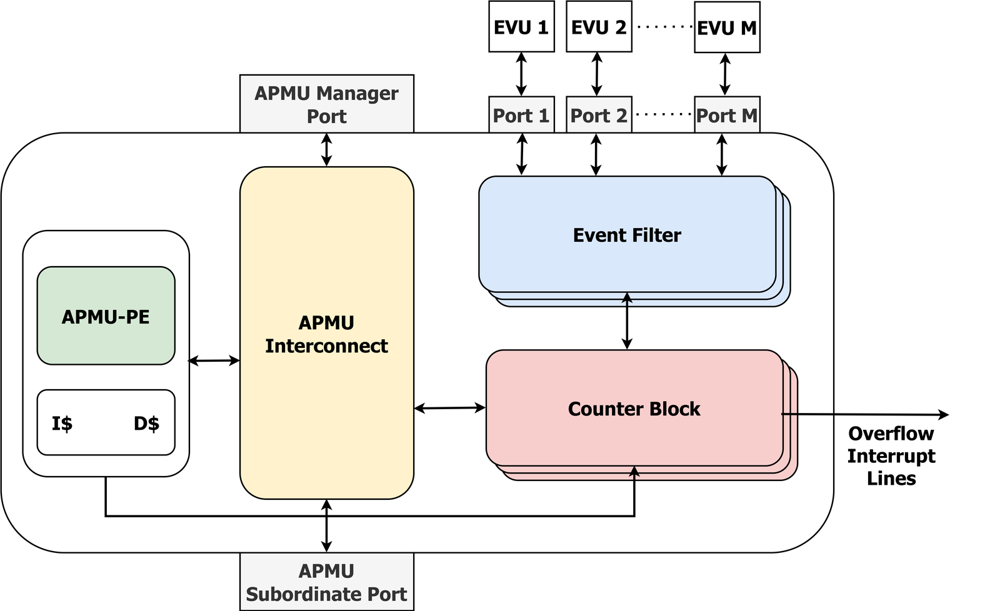

# Advanced Performance Monitoring Unit (APMU)

The **APMU** is a centralized, AXI4-based performance-monitoring unit. It aggregates the
microarchitectural events forwarded by the per-core **Event Monitoring Units (EVUs)** and
the **SPU** interconnect snoopers, counts and correlates them in a bank of programmable
counters, and runs event-driven monitoring policies on an embedded processing element (a
lowRISC **Ibex** core) — entirely off the application cores. It is the central IP of the
performance-monitoring architecture in our EMSOFT 2026 paper.

## How it works

- **Event ports** (`pmu_port`, `pmu_port_wrap`). Each EVU connects to a dedicated APMU port
  (`Port_1 … Port_M`) that receives its microarchitectural-event stream.
- **Event Filter + Counter Block** (`pmu_counter`), replicated `NUM_COUNTERS` times. Each
  counter selects the event(s) it tracks (its *Event-Select* register), optionally captures
  an info field (e.g. per-access latency), and raises an **overflow interrupt** to the
  system interrupt controller when it crosses its budget/threshold.
- **APMU processing element (APMU-PE) and scratchpads** (`pmu_core`, `pmu_ispm`,
  `pmu_dspm`). A lowRISC Ibex core with instruction (`I$`) and data (`D$`) scratchpad
  memories runs the monitoring firmware that programs the counters, reads results, and
  reacts to events (e.g. memory-bandwidth regulation) without involving the application
  cores.
- **APMU interconnect** ties the core, counters, and register interface together.
- **Register ports.** The **Read-Write Manager port** lets the APMU core reach out to the
  rest of the system; the **Read-Write Subordinate port** exposes the APMU's registers and
  scratchpads to the application cores over **AXI4-Lite**.

## Source layout (`src/`)

| File | Role |
|------|------|
| `pmu_top.sv` | Top-level integration (register interface, counters, core, ports). |
| `pmu_core.sv` | Ibex-based processing element wrapper. |
| `pmu_counter.sv` | Event filter + programmable counter (instantiated `NUM_COUNTERS`×). |
| `pmu_port.sv`, `pmu_port_wrap.sv` | EVU event-ingress ports. |
| `pmu_ispm.sv`, `pmu_dspm.sv` | Instruction / data scratchpad memories for the PE. |
| `pmu_gnt_to_axi_lite.sv` | Request-grant → AXI4-Lite adapter. |
| `pmu_pkg.sv` | Package: types and parameters. |

Depends on the `ibex_pmu` core and the PULP `axi` / `common_cells` libraries (see
[`Bender.yml`](./Bender.yml)). The AXI4-Lite register interface is implemented in the style
of AlSaqr's `axi_lite_regs` / `axi_llc_config`.

## Register map

Each counter and its configuration registers occupy a separate 4 KiB page:

| Register | Address | Page |
|----------|---------|------|
| Timer | `0x10405000` | – |
| Period Reg | `0x10405008` | – |
| Status Reg | `0x10406000` | – |
| Boot Addr Reg | `0x10406004` | – |
| Counter 0 | `0x10407000` | Page 0 |
| Event Sel 0 | `0x10407004` | Page 0 |
| Event Info 0 | `0x10407008` | Page 0 |
| Info Budget 0 | `0x1040700C` | Page 0 |
| Counter 1 | `0x10408000` | Page 1 |
| … | … | … |

> **Implementation note.** The AXI4-Lite reads/writes are serviced by AlSaqr's
> `axi_lite_regs` IP, which expects a *contiguous* byte array, whereas the counters are
> paged at 4 KiB boundaries. `pmu_top.sv` bridges the two: a register at address
> `0x104X_Y00Z` maps onto the contiguous space at byte `XYZ` (a simple bit-shift), using a
> `PadB_NumBytes` padding that depends on the APMU base address.

## Simulation

Unit testbenches are under [`test/`](./test) (`tb_pmu.sv`, `tb_pmu_spm.sv`, `tb_pmu_pkg.sv`,
`tb_axi_lite_regs.sv`); compile/run scripts are in [`scripts/`](./scripts)
(`compile_vsim.sh`, `run_vsim.sh`). In the full SoC the APMU is instantiated in
`hardware/host/host_domain.sv`.

## License

Released under the **Solderpad Hardware License v0.51** (treatable, at the licensee's
option, as Apache-2.0). See [`LICENSE`](./LICENSE).
