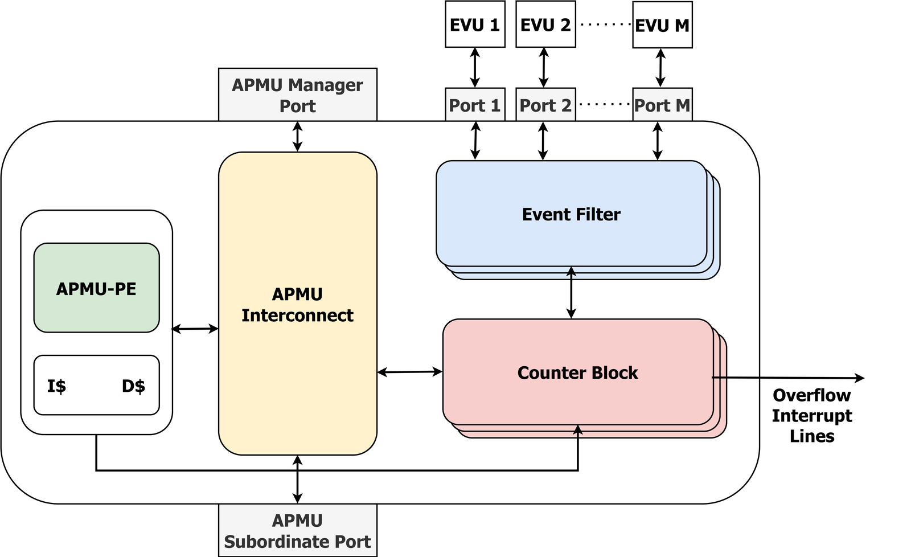

# Advanced Performance Monitoring Unit (APMU)

The **APMU** is a centralized, AXI4-based performance-monitoring unit. It aggregates the
microarchitectural events forwarded by the per-core **Event Monitoring Units (EVUs)** and
the **SPU** interconnect snoopers, counts and correlates them in a bank of programmable
counters, and runs event-driven monitoring policies on an embedded processing element (a
lowRISC **Ibex** core) — entirely off the application cores. It is the central IP of the
performance-monitoring architecture in our EMSOFT 2026 paper.

## How it works

- **Event ports** (`pmu_port`, `pmu_port_wrap`). Each EVU connects to a dedicated APMU port
  (`Port_1 … Port_M`) that receives its microarchitectural-event stream.
- **Event Filter + Counter Block** (`pmu_counter`), replicated `NUM_COUNTERS` times. Each
  counter selects the event(s) it tracks (its *Event-Select* register), optionally captures
  an info field (e.g. per-access latency), and raises an **overflow interrupt** to the
  system interrupt controller when it crosses its budget/threshold.
- **APMU processing element (APMU-PE) and scratchpads** (`pmu_core`, `pmu_ispm`,
  `pmu_dspm`). A lowRISC Ibex core with instruction (`I$`) and data (`D$`) scratchpad
  memories runs the monitoring firmware that programs the counters, reads results, and
  reacts to events (e.g. memory-bandwidth regulation) without involving the application
  cores.
- **APMU interconnect** ties the core, counters, and register interface together.
- **Register ports.** The **Read-Write Manager port** lets the APMU core reach out to the
  rest of the system; the **Read-Write Subordinate port** exposes the APMU's registers and
  scratchpads to the application cores over **AXI4-Lite**.

## Source layout (`src/`)

| File | Role |
|------|------|
| `pmu_top.sv` | Top-level integration (register interface, counters, core, ports). |
| `pmu_core.sv` | Ibex-based processing element wrapper. |
| `pmu_counter.sv` | Event filter + programmable counter (instantiated `NUM_COUNTERS`×). |
| `pmu_port.sv`, `pmu_port_wrap.sv` | EVU event-ingress ports. |
| `pmu_ispm.sv`, `pmu_dspm.sv` | Instruction / data scratchpad memories for the PE. |
| `pmu_gnt_to_axi_lite.sv` | Request-grant → AXI4-Lite adapter. |
| `pmu_pkg.sv` | Package: types and parameters. |

Depends on the `ibex_pmu` core and the PULP `axi` / `common_cells` libraries (see
[`Bender.yml`](./Bender.yml)). The AXI4-Lite register interface is implemented in the style
of AlSaqr's `axi_lite_regs` / `axi_llc_config`.

## Register map

Each counter and its configuration registers occupy a separate 4 KiB page:

| Register | Address | Page |
|----------|---------|------|
| Timer | `0x10405000` | – |
| Period Reg | `0x10405008` | – |
| Status Reg | `0x10406000` | – |
| Boot Addr Reg | `0x10406004` | – |
| Counter 0 | `0x10407000` | Page 0 |
| Event Sel 0 | `0x10407004` | Page 0 |
| Event Info 0 | `0x10407008` | Page 0 |
| Info Budget 0 | `0x1040700C` | Page 0 |
| Counter 1 | `0x10408000` | Page 1 |
| … | … | … |
| ISPM (8 KiB) | `0x10427000` | – |
| DSPM (128 KiB) | `0x10429000` | – |

The scratchpads are those of `pmu_top` in `hardware/host/host_domain.sv` (the DSPM moved from `0x10428000` when the
ISPM grew to 8 KiB in 05eee786). The PE fetches from the ISPM; its data port reaches only the DSPM, the registers
above (`0x10405000`-`0x10426FFF`) and the cores' EVU registers (`0x10606000`-`0x106060FF`; `0x106061FF` with eight
cores, the window `ariane_soc::PerfcEvuLength` that the cores use too). A PE load or store to any other address is
never granted: the PE stalls instead of trapping (`pmu_core.sv`). The cores reach both scratchpads
over AXI4-Lite. Load them with aligned 32-bit stores: the scratchpads index their SRAM by byte address, so a byte or
halfword store lands in a lane the PE does not read (the bare-metal `memcpy`, `software/common/syscalls.c`, stores
bytes unless the size is a multiple of 8). `software/quad_boot/pmu_defines.h` has the addresses for the cores and the
PE firmware; the firmware's linker scripts put its data at `DSPM + 0x200`, where the loaders copy it.

A counter overflows when its bit 30 sets (counting past `0x3FFFFFFF`, or a write of `0x40000000`). With
`overflow_intr_en` (Event Info bit 24, `OVERFLOW_EN`) set, counter *i* raises PLIC source 156 + *i* (`pmu_top.sv`,
`hardware/host/ariane_peripherals.sv`). Harts 2 and up wait in a WFI of the boot ROM: software wakes hart *h* by
enabling source 156 + *h* - 2 on its S-mode PLIC context 2*h* + 1 and overflowing counter *h* - 2, so sources 156 and
157 on contexts 5 and 7 with four cores (`soc_wake_all()` in `software/soc_tests/include/soc_test.h`, which also
takes the wake-up back).

### Event select and sources (AlSaqr)

A counter's Event Sel register holds a value and a mask for the port, the source and the event
(`pmu_pkg::event_sel_cfg_t`). The port and source fields follow the core count (the `NUM_CVA6` define;
`pmu_pkg::PORT_ID_BITS`, `SOURCE_ID_BITS`): 4 bits each with up to four cores, the layout the existing quad-core
software uses, and 5 bits with more cores, where the pad shrinks from 8 bits to 4 and the register stays 32 bits:

| Cores | Event Sel |
|---|---|
| up to 4 | pad [31:24], port value [23:20], port mask [19:16], source value [15:12], source mask [11:8], event value [7:4], event mask [3:0] |
| 5 and more | pad [31:28], port value [27:23], port mask [22:18], source value [17:13], source mask [12:8], event value [7:4], event mask [3:0] |

A select is `port << 20 | pmask << 16 | src << 12 | smask << 8 | ev << 4 | emask` on a four-core bitstream and
`port << 23 | pmask << 18 | src << 13 | smask << 8 | ev << 4 | emask` on one with more cores, so software has to be
built for the bitstream's core count: a select in the other layout counts the wrong port or nothing, without any error
(the four-core `0x9F4F1F` reads as port 1 under mask 7 and source 26 under mask 15 with eight cores, which never
matches). The counter counts an event when `(mask & field) == value` holds for all three fields and the event value
is not 0: an event value of 0 turns the counter off (`pmu_port.sv`), so no select counts every event of a port; count
each event ID on a counter of its own.

Ports with *N* cores: 1..*N* the cores' EVUs, *N*+1..2*N* the SPUs on the cores' ports to the LLC, 2*N*+1 the SPU on
the LLC memory port (all DRAM traffic), 2*N*+2 the SPU on the accelerator socket's DMA (below). With four cores that is
1-4, 5-8, 9 and 10, with eight 1-8, 9-16, 17 and 18 (`ariane_soc::Apmu*Idx`: element *i* of `spu_o` in
`hardware/host/host_domain.sv` is port *i* + 1). A select names a port by its `PORT_ID`: 4 bits hold ports 1-15, 5 bits
ports 1-31. The simulation stops at time 0 if the ports or the memory port's sources do not fit the fields
(`host_domain.sv`, `pmu_top.sv`), which happens beyond 14 cores. SPU events: 1 read request, 2 write request, 3 read
response, 4 write response. On ports *N*+1..2*N* (5-8 with four cores, 9-16 with eight) the source is bit 0 of the
core's AXI ID (`i_spu_core_llc` in `hardware/host/cva6_synth_wrap.sv`), which does not tell masters apart: the port is
the core.

On ports 1..*N* the event field is a bitmap of the core's four EVU slots, bit *s* set in a cycle in which slot *s* sees
its event, and the source is 0: slot *s* of core *c* is the select with port value *c* + 1 and event value and mask
`1 << s` (core 0, slot 1: `0x1F0022` with four cores, `0xFC0022` with eight). A slot's event ID picks its event
(`hardware/ip_list/cva6/core/perf_counters_evu.sv`):

| ID | Event | ID | Event | ID | Event |
|---|---|---|---|---|---|
| 0x00 | off | 0x08 | exception return | 0x10 | L1 I-cache access |
| 0x01 | L1 I-cache miss | 0x09 | branch | 0x11 | L1 D-cache access |
| 0x02 | L1 D-cache miss | 0x0A | branch mispredict | 0x12 | cache eviction |
| 0x03 | ITLB miss | 0x0B | branch exception | 0x13 | I-TLB flush |
| 0x04 | DTLB miss | 0x0C | call | 0x14 | integer instruction |
| 0x05 | load | 0x0D | return | 0x15 | FP instruction |
| 0x06 | store | 0x0E | MSB full | 0x16 | pipeline bubble |
| 0x07 | exception | 0x0F | instruction fetch empty | 0x17 | PC milestone |

The event IDs are 32-bit registers at `0x10606000 + 0x30*c` (`hardware/host/cva6_synth_wrap.sv`) in reverse slot
order: `+0x0` programs slot 3, `+0xC` slot 0 (`EVU_EID_REG(core, slot)` in `software/quad_boot/pmu_defines.h`). The
four 64-bit PC milestones follow in order, milestone *m* at `+0x10 + 8*m`. A slot with event ID 0x17 fires when the
core commits one of the milestone PCs, and bit *m* of the event's info field says which; an Event Info configuration
that adds that bit counts one milestone (`software/c1_v2`). With eight cores, core 7's registers start at `0x10606150`
and end at `0x1060617F`, inside the window of 0x200 bytes (0x100 with four cores). `software/soc_tests/t_evu` writes
and reads back every core's registers, has the PE copy them all, and checks that each core's events reach its own port
and slot and no other.

On port 2*N*+1 (9 with four cores, 17 with eight) the source says who caused the traffic
(`hardware/include/ariane_soc_pkg.sv`, `ariane_axi_soc::mem_src`):

| Source, four cores | Source, eight cores | Master |
|---|---|---|
| 0-3 | 0-7 | the cores (ports 0..*N*-1 of the coherence unit) |
| 4 | 8 | the accelerator socket's DMA (coherence-unit port *N*, `ariane_soc::CcuAccelPort`) |
| 5 | 9 | the Xilinx Ethernet's AXI DMA (coherence-unit port *N*+1, `CcuEthPort`) |
| 6 | 10 | debug module |
| 7, 8 | 11, 12 | cluster port, RoT (idle) |
| 9, 10 | 13, 14 | uDMA TX, uDMA RX |
| 11, 12 | 15, 16 | IOMMU completion port (iDMA), IOMMU data structures |
| 13, 14 | 17, 18 | IOPMP initiator (idle), APMU master (does not reach DRAM) |

The cores' and the two DMA masters' numbers are the coherence unit's source port, which travels in the AXI user field
(`user[QosUserLsb-1:0]`, `hardware/docs/qos.md`). The other masters get `NumCcuPorts + p - 1` for crossbar port `p`
(until the Ethernet DMA had a coherence-unit port of its own, source 4 was both DMAs and every number from the debug
module's on was one lower). A response counts for the source of its request. A write-back the coherence unit issues
for snooped dirty data counts for the core that held the data, an LLC eviction for the request whose miss caused it,
and LLC flushes for source 0. The numbers follow the package when masters are added; the simulation checks that
`NumMemSrcs` fits the source field (`MemSrcWidth` = `pmu_pkg::SOURCE_ID_BITS`): the 15 codes of four cores fit 4 bits,
the 19 of eight cores 5 bits. Examples with four cores: `0x9F4F1F` counts the socket DMA's read requests, `0x9F5F1F`
the Ethernet DMA's, `0x9F001F` every read request on port 9 (`software/quad_boot/pmu_defines.h`;
`software/soc_tests/t_srcid` checks them). The same with eight cores, on port 17: `0x08FD1F1F`, `0x08FD3F1F` and
`0x08FC001F`; core *c*'s read requests there are `0x08FC1F1F + (c << 13)`.

Port 2*N*+2 (10 with four cores, 18 with eight) is an SPU on the accelerator socket's DMA master (`i_spu_accel` in
`hardware/host/cva6_subsystem.sv`), in front of the socket's port of the coherence unit as the cores' SPUs are in front
of theirs. It sees the accelerators' requests before the coherence unit and the LLC, so every DRAM request counts once,
LLC hit or miss, and nothing else: the Ethernet DMA has a coherence-unit port of its own, and the CPU's accesses to the
socket's registers take another path. Its events are those of the other SPUs, for DRAM addresses only (DMA to the
on-chip SRAM or the LLC scratchpad does not count): a request carries its size in bytes (8 for every socket request), a
response its latency in cycles. Every event has source *N* (`CcuAccelPort`: 4 with four cores, 8 with eight), the code
port 2*N*+1 gives the socket's requests too; which slot made a request is not recorded. Next to port 2*N*+1 it tells
what of the socket's traffic reached DRAM: port 2*N*+1's source *N* is all of it outside the LLC window, inside the
window only the refills its LLC misses cause (and the evictions they force). Examples with four cores: `0xAF4F1F` read
requests, `0xAF4F3F` read responses (`ACC_*` in `software/quad_boot/pmu_defines.h`; `software/soc_tests/t_srcid`
compares them with port 9's source 4 and requires 0 while only the cores or the Ethernet DMA are busy); with eight
cores `0x097D1F1F` and `0x097D1F3F`.

A counter that adds or compares Event Info (latency or size sums, `ADD_RESP_LAT`) takes one port's info per cycle: when
several ports match it in the same cycle, the highest-numbered port's info is used and the others' are lost
(`pmu_port_wrap.sv`), so give such a counter a single port. A counter without Event Info adds up every matching port.

> **Implementation note.** The AXI4-Lite reads/writes are serviced by AlSaqr's
> `axi_lite_regs` IP, which expects a *contiguous* byte array, whereas the counters are
> paged at 4 KiB boundaries. `pmu_top.sv` bridges the two: a register at address
> `0x104X_Y00Z` maps onto the contiguous space at byte `XYZ` (a simple bit-shift), using a
> `PadB_NumBytes` padding that depends on the APMU base address.

## Simulation

Unit testbenches are under [`test/`](./test) (`tb_pmu.sv`, `tb_pmu_spm.sv`, `tb_pmu_pkg.sv`,
`tb_axi_lite_regs.sv`); compile/run scripts are in [`scripts/`](./scripts)
(`compile_vsim.sh`, `run_vsim.sh`). In the full SoC the APMU is instantiated in
`hardware/host/host_domain.sv`.

## License

Released under the **Solderpad Hardware License v0.51** (treatable, at the licensee's
option, as Apache-2.0). See [`LICENSE`](./LICENSE).
