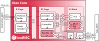

# APMU-PE — Ibex modified for the Advanced Performance Monitoring Unit

> **This is a modified fork of the lowRISC Ibex core.** It is used as the **processing
> element (APMU-PE)** inside our [APMU](../apmu) — the green `APMU-PE` block in the APMU
> block diagram — where it runs the monitoring firmware that programs counters, reads
> results, and reacts to events, entirely off the application cores. lowRISC's original Ibex
> README is preserved unchanged below this section.

**Configuration.** A 32-bit **RV32IMC** Ibex with a two-stage pipeline (IF, ID/EX), no
instruction cache and no branch predictor, executing from dedicated **instruction / data
scratchpad memories (ISPM / DSPM)** — ISPM fetches complete in 1 cycle, DSPM loads/stores in
2 cycles.

**Custom control instructions.** To reach the APMU counters and react to events *without*
going through the memory interface, the core extends the base ISA with four custom
instructions on the previously-unused opcode **`0x07`** (`OPCODE_COUNTER`, `7'b000_0111`),
decoded only when the `PMUCore` parameter is set:

| Instruction | opcode | funct3 | funct7 | Operation |
|---|---|---|---|---|
| **Counter Read** | `0x07` | `0x0` | — | `rd = counter[rs1]` — direct read over a dedicated datapath, 2 cycles, no memory access |
| **Counter Write** | `0x07` | `0x1` | — | `counter[rs2] = rs1` |
| **Wait-for-Pending** | `0x07` | `0x2` | `0x00` | block until any counter selected by the `rs1` 32-bit bitmap asserts its *pending* flag, then resume with the bitmap of triggering counters |
| **Wait-for-Overflow** | `0x07` | `0x2` | `0x01` | block until any counter selected by the `rs1` bitmap asserts its *overflow* flag |

Because the wait bitmap is 32 bits wide, the APMU supports at most **32 counters**. The
instructions are exposed to firmware as inline-assembly macros (`counter_read`,
`counter_write`, … using `.insn r 0x07, …`) — see `pmu_hw_desc.h` in the
[`apmu-software`](https://github.com/Rodolfo-Pellizzoni-Lab/apmu-software) repository.

**Where the changes are** (the namespaced `apmu_ibex_*` fork):

| File | Change |
|------|--------|
| `rtl/ibex_pmu_counter.sv` | **New (ours).** The PMU Counter Unit — the dedicated counter-access datapath. |
| `rtl/ibex_decoder.sv` (`apmu_ibex_decoder`) | Decodes `OPCODE_COUNTER` and drives the counter op / wait states, gated by the `PMUCore` parameter. |
| `rtl/ibex_core.sv` | Instantiates the counter unit and integrates the Wait-for-Pending / Wait-for-Overflow stalls. |
| `rtl/ibex_pkg.sv` (`apmu_ibex_pkg`) | Adds the counter-operation types (`pmc_op_e`: `PMC_REQ`, `PMC_WFP`, `PMC_WFO`). |

**License.** Our additions (`ibex_pmu_counter.sv` and the `PMUCore`-gated changes) are under
the **Solderpad Hardware License v0.51**; the underlying Ibex core remains under lowRISC's
original **Apache-2.0** license. See the upstream `LICENSE` in this directory.

---

<!-- ================= Upstream lowRISC Ibex README (unmodified) below ================= -->

# Ibex RISC-V Core

Ibex is a small and efficient, 32-bit, in-order RISC-V core with a 2-stage pipeline that implements
the RV32IMC instruction set architecture.

This core was initially developed as part of the [PULP platform](https://www.pulp-platform.org)
under the name "Zero-riscy" \[[1](https://doi.org/10.1109/PATMOS.2017.8106976)\], and has been
contributed to [lowRISC](https://www.lowrisc.org) who maintains it and develops it further. It is
under active development, with further code cleanups, feature additions, and test and verification
planned for the future.

## Configuration

Ibex offers several configuration parameters to meet the needs of various application scenarios.
The options include different choices for the architecture of the multiplier unit, as well as a range of performance and security features.
The table below indicates performance, area and verification status for a few selected configurations.
These are configurations on which lowRISC is focusing for performance evaluation and design verification (see [supported configs](ibex_configs.yaml)).

| Config | "micro" | "small" | "maxperf" | "maxperf-pmp-bmfull" |
| ------ | ------- | --------| ----------| -------------------- |
| Features | RV32EC | RV32IMC, 3 cycle mult | RV32IMC, 1 cycle mult, Branch target ALU, Writeback stage | RV32IMCB, 1 cycle mult, Branch target ALU, Writeback stage, 16 PMP regions |
| Performance (CoreMark/MHz) | 0.904 | 2.47 | 3.13 | 3.05 |
| Area - Yosys (kGE) | 17.44 | 26.06 | 35.64 | 58.74 |
| Area - Commercial (estimated kGE) | ~16 | ~24 | ~33 | ~54 |
| Verification status | Red | Green | Amber | Amber |

Notes:

* Performance numbers are based on CoreMark running on the Ibex Simple System [platform](examples/simple_system/README.md).
  Note that different ISAs (use of B and C extensions) give the best results for different configurations.
  See the [Benchmarks README](examples/sw/benchmarks/README.md) for more information.
  The "maxperf-pmp-bmfull" configuration sets a `SpecBranch` parameter in `ibex_core.sv`; this helps timing but has a small negative performance impact.
* Yosys synthesis area numbers are based on the Ibex basic synthesis [flow](syn/README.md) using the latch-based register file.
* Commercial synthesis area numbers are a rough estimate of what might be achievable with a commercial synthesis flow and technology library.
* For comparison, the original "Zero-riscy" core yields an area of 23.14kGE using our Yosys synthesis flow.
* Verification status is a rough guide to the overall maturity of a particular configuration.
  Green indicates that verification is close to complete.
  Amber indicates that some verification has been performed, but the configuration is still experimental.
  Red indicates a configuration with minimal/no verification.
  Users must make their own assessment of verification readiness for any tapeout.
* v0.92 of the RISC-V Bit Manipulation Extension is supported.
  This is *not ratified* and there may be changes for the v1.0 ratified version.
  See [Standards Compliance](https://ibex-core.readthedocs.io/en/latest/01_overview/compliance.html) in the Ibex documentation for more information.

## Documentation

The Ibex user manual can be
[read online at ReadTheDocs](https://ibex-core.readthedocs.io/en/latest/). It is also contained in
the `doc` folder of this repository.

## Contributing

We highly appreciate community contributions. To ease our work of reviewing your contributions,
please:

* Create your own branch to commit your changes and then open a Pull Request.
* Split large contributions into smaller commits addressing individual changes or bug fixes. Do not
  mix unrelated changes into the same commit!
* Write meaningful commit messages. For more information, please check out the [contribution
  guide](https://github.com/lowrisc/ibex/blob/master/CONTRIBUTING.md).
* If asked to modify your changes, do fixup your commits and rebase your branch to maintain a
  clean history.

When contributing SystemVerilog source code, please try to be consistent and adhere to [our Verilog
coding style guide](https://github.com/lowRISC/style-guides/blob/master/VerilogCodingStyle.md).

When contributing C or C++ source code, please try to adhere to [the OpenTitan C++ coding style
guide](https://docs.opentitan.org/doc/rm/c_cpp_coding_style/).
All C and C++ code should be formatted with clang-format before committing.
Either run `clang-format -i filename.cc` or `git clang-format` on added files.

To get started, please check out the ["Good First Issue"
 list](https://github.com/lowrisc/ibex/issues?q=is%3Aissue+is%3Aopen+label%3A%22Good+First+Issue%22).

## Issues and Troubleshooting

If you find any problems or issues with Ibex or the documentation, please check out the [issue
 tracker](https://github.com/lowrisc/ibex/issues) and create a new issue if your problem is
not yet tracked.

## Questions?

Do not hesitate to contact us, e.g., on our public [Ibex channel on
Zulip](https://lowrisc.zulipchat.com/#narrow/stream/198227-ibex)!

## License

Unless otherwise noted, everything in this repository is covered by the Apache
License, Version 2.0 (see LICENSE for full text).

## Credits

Many people have contributed to Ibex through the years. Please have a look at
the [credits file](CREDITS.md) and the commit history for more information.

## References
1. [Schiavone, Pasquale Davide, et al. "Slow and steady wins the race? A comparison of
 ultra-low-power RISC-V cores for Internet-of-Things applications."
 _27th International Symposium on Power and Timing Modeling, Optimization and Simulation
 (PATMOS 2017)_](https://doi.org/10.1109/PATMOS.2017.8106976)
