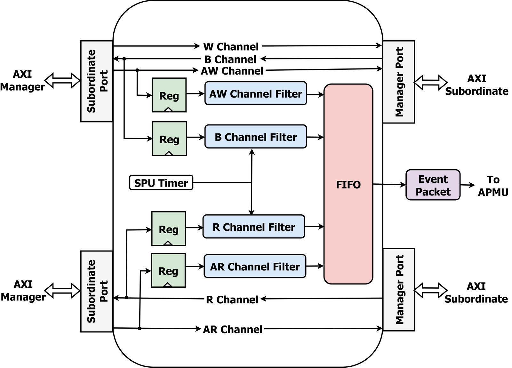

# SPU — AXI4 / ACE Event Snooper

The **SPU** is a non-intrusive snooper that sits transparently on an AXI4 (or ACE) link —
between a manager and a subordinate — and forwards **event packets** describing the traffic
it observes to the **APMU**. It is how interconnect- and memory-side events (e.g. LLC and
main-memory read/write requests, and per-access latency) enter the centralized monitor. It
is one of the three IPs of the performance-monitoring architecture in our EMSOFT 2026 paper,
alongside the APMU and the per-core EVUs.

<p align="center"></p>

## How it works

- The five AXI channels pass **transparently** from the subordinate-side port (`Sb Port`,
  facing the managers) to the manager-side port (`Mn Port`, facing the subordinate) — the SPU
  never alters or delays the traffic it monitors.
- It tracks **read** transactions through the address-read (**AR**) and read-data (**R**)
  channels, and **write** transactions through the address-write (**AW**) and write-response
  (**B**) channels; the write-data (**W**) channel is not monitored. Each monitored channel is
  **sampled** (the `Reg` stage) and passed through a filter that decides which transactions
  produce events and extracts their fields (an event ID plus metadata such as transaction
  size, alignment, or response latency).
- An **SPU timer** timestamps requests and responses, so latency is measured as the time
  between a request and its corresponding response completion.
- Each event type is handled by a dedicated pipeline, and the resulting **event packets are
  stored in a FIFO** that forms the SPU's output interface to the APMU.

## Variants

- `axi_spu_top.sv` — AXI4 snooper.
- `ace_spu_top.sv` — ACE snooper. **On this branch the master/slave ports are wired as
  `ACE_BUS`** (rather than `AXI_BUS`) so the SPU can observe coherent traffic.

## Source layout (`src/`)

| File | Role |
|------|------|
| `axi_spu_top.sv`, `ace_spu_top.sv` | Top-level snooper (AXI4 / ACE). |
| `spu_ax_chan.sv` | Address-channel (AR / AW) event extraction. |
| `spu_r_chan.sv` | Read-transaction tracking: matches an AR request to its R response (read latency). |
| `spu_w_chan.sv` | Write-transaction tracking: matches an AW request to its B response (write latency). |
| `spu_arbiter.sv` | Round-robin merge of the per-pipeline events into the output FIFO. |
| `spu_pkg.sv` | Package: types and parameters. |

Depends on the PULP `axi`, `ace`, and `apmu` packages (see [`Bender.yml`](./Bender.yml));
reusable AXI `typedef`/`assign` macros are in [`include/axi/`](./include/axi).

## Simulation

```
bender update
cd scripts
./compile_vsim.sh
./run_vsim.sh
python3 post_sim_script.py <TbMasters> <TbNumReads> <TbNumWrites>
```

Testbench sources are in [`test/`](./test) (`tb_spu.sv`, `spu_test.sv`). In the full SoC,
SPUs are instantiated in `hardware/host/host_domain.sv` — on the coherent interconnect and
at the LLC↔memory port.

## License

Released under the **Solderpad Hardware License v0.51** (treatable, at the licensee's
option, as Apache-2.0). See [`LICENSE`](./LICENSE).
